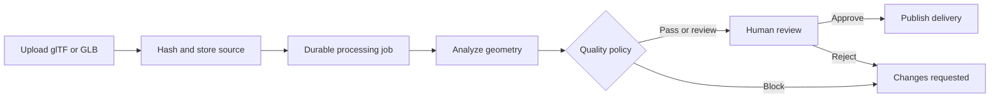
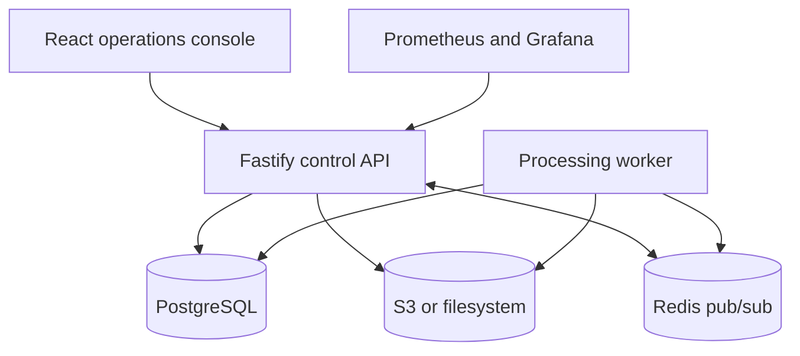

# ForgeFlow

### Realtime 3D Asset Operations Platform

[](https://github.com/dragon122177/realtime-asset-service/actions/workflows/ci.yml)
[](https://github.com/dragon122177/realtime-asset-service/actions/workflows/codeql.yml)
[](https://nodejs.org/)
[](https://www.postgresql.org/)
[](LICENSE)

ForgeFlow is a full-stack control plane for ingesting, validating, reviewing, versioning, and delivering glTF/GLB assets. It models a real production concern: 3D files move through several people and systems before they are safe to publish, but teams still need one traceable view of quality, processing, approvals, and failures.

This repository is a provider-neutral reference implementation built with TypeScript, React, PostgreSQL, Redis, S3-compatible storage, and Three.js. All included users, projects, assets, and organizations are synthetic.

## What it demonstrates

| Area        | Implementation                                                                                                       |
| ----------- | -------------------------------------------------------------------------------------------------------------------- |
| Backend     | Fastify API, Zod validation, JWT authentication, RBAC, range requests, structured errors, correlation IDs            |
| Data        | PostgreSQL schemas, lifecycle constraints, row-level security policies, immutable audit records, migration checksums |
| Async work  | Durable jobs, atomic claims with `FOR UPDATE SKIP LOCKED`, leases, retry backoff, stale-job recovery                 |
| 3D pipeline | Real glTF 2.0/GLB parsing, geometry metrics, quality budgets, immutable source and delivery versions                 |
| Frontend    | React 19 operations console, TanStack Query, live invalidation, Three.js WebGL preview, responsive UI                |
| Platform    | Docker Compose, MinIO, Redis, Prometheus, Grafana, Kubernetes manifests, HPA/PDB/network policy                      |
| Delivery    | Unit and PostgreSQL integration tests, API coverage gates, container builds, CodeQL, Dependabot                      |

## Workflow



The source file is immutable. A worker reads it from object storage, parses the actual glTF/GLB structure, records metrics and findings, creates a deterministic delivery version, and opens a human review. Approvals publish the delivery version; reprocessing creates a new revision rather than rewriting history.

## Architecture



PostgreSQL is the system of record. Redis only distributes low-latency UI invalidations, so losing Redis does not lose jobs or asset state. The API and worker share domain rules but run as independent processes and can scale separately.

See [Architecture](docs/architecture.md), [Data model](docs/data-model.md), and [ADRs](docs/adr/) for the reasoning behind those boundaries.

## Quick start

Requirements: Docker with Compose v2.

```bash
docker compose up --build
```

After the seed and worker complete their first pass:

| Service           | URL                                  |
| ----------------- | ------------------------------------ |
| ForgeFlow console | <http://localhost:3000>              |
| API health        | <http://localhost:8080/health/ready> |
| MinIO console     | <http://localhost:9001>              |
| Prometheus        | <http://localhost:9090>              |
| Grafana           | <http://localhost:3001>              |

Demo login:

```text
admin@forgeflow.local
ForgeFlow!2026
```

The seed is idempotent and creates four roles, three projects, and three valid synthetic glTF assets. Local credentials are deliberately obvious and must never be reused outside local development.

Stop the stack with `docker compose down`. Add `--volumes` only when you intentionally want to delete local database and object-storage data.

## Local development

Use Node.js 22, npm 10+, PostgreSQL 16, and optionally Redis. The filesystem storage adapter lets the application run without MinIO.

```bash
cp .env.example .env
npm ci
npm run db:migrate
npm run db:seed
npm run dev
```

Run the worker in a second terminal:

```bash
npm run dev:worker
```

The Vite console is available at <http://localhost:5173>; the API listens on <http://localhost:8080>.

## API surface

| Method     | Endpoint                       | Purpose                                                |
| ---------- | ------------------------------ | ------------------------------------------------------ |
| `POST`     | `/api/v1/auth/login`           | Exchange credentials for a bearer token                |
| `GET`      | `/api/v1/dashboard`            | Workspace operational summary                          |
| `GET/POST` | `/api/v1/assets`               | Search assets or upload one glTF/GLB source            |
| `GET`      | `/api/v1/assets/:id`           | Asset, versions, metrics, history, and timeline        |
| `GET`      | `/api/v1/assets/:id/content`   | Stream source/delivery content with byte-range support |
| `POST`     | `/api/v1/assets/:id/reprocess` | Queue a new immutable revision                         |
| `GET`      | `/api/v1/jobs`                 | Inspect processing jobs                                |
| `POST`     | `/api/v1/jobs/:id/retry`       | Retry a failed processing job                          |
| `GET`      | `/api/v1/reviews`              | Inspect the human review queue                         |
| `POST`     | `/api/v1/reviews/:id/decision` | Approve a delivery or request changes                  |
| `GET`      | `/api/v1/audit`                | Append-only security and workflow audit trail          |
| `GET`      | `/api/v1/live`                 | Ticketed Server-Sent Events stream                     |

The complete contract is in [`docs/openapi.yaml`](docs/openapi.yaml).

## Repository map

```text
apps/api/              Fastify API, worker, domain services, and tests
apps/web/              React operations console and Three.js preview
database/migrations/   Versioned PostgreSQL schema and governance rules
docs/                  Architecture, contracts, runbooks, and ADRs
infra/                 Prometheus, Grafana, and Kubernetes resources
samples/               Small synthetic glTF fixtures
```

## Verification

```bash
npm run check
npm run test:coverage
```

The test suite covers binary and JSON glTF parsing, quality policy evaluation, lifecycle rules, byte ranges, retry behavior, UI components, and PostgreSQL-specific behavior. In CI, the PostgreSQL tests run against a real PostgreSQL 16 service and exercise migrations, RLS policies, transition triggers, immutable audits, and concurrent job claims.

## Security and operational boundaries

- Bearer tokens are short-lived application credentials; passwords use bcrypt.
- A 60-second narrow-purpose ticket keeps bearer tokens out of SSE URLs.
- Workspace filters are enforced in repositories, with PostgreSQL RLS policies as defense in depth.
- Upload type, size, extension, and glTF structure are validated before queueing.
- Sensitive request fields are redacted from logs; write operations carry correlation IDs.
- Source and delivery object keys are content-addressed and cannot traverse the storage root.
- Audit rows are append-only at the database layer.

For a real deployment, use separate migration and runtime database roles, managed secrets, TLS, private object storage, signed delivery URLs, malware scanning, and a production identity provider. See [Security model](docs/security-model.md).

## Honest scope

ForgeFlow's built-in processor performs deterministic validation, analysis, quality evaluation, and packaging. It does **not** claim to run proprietary mesh reduction, texture transcoding, or Draco compression. The [processor contract](docs/processor-contract.md) shows where a Blender, glTF-Transform, GPU, or managed optimization adapter can be integrated without coupling that implementation to the control plane.

## Documentation

- [Architecture](docs/architecture.md)
- [Asset lifecycle](docs/asset-pipeline.md)
- [Data model](docs/data-model.md)
- [Processor contract](docs/processor-contract.md)
- [Security model](docs/security-model.md)
- [Operations runbook](docs/operations-runbook.md)
- [Testing strategy](docs/testing.md)
- [OpenAPI 3.1 contract](docs/openapi.yaml)

## License

[MIT](LICENSE)
