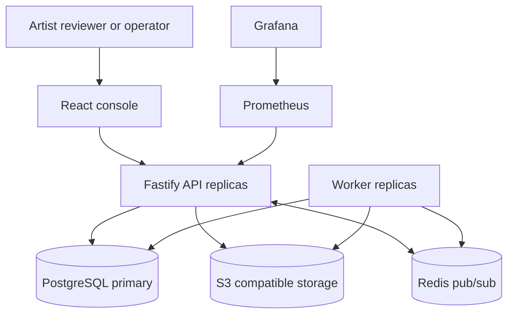

# Architecture

## System context

ForgeFlow sits between 3D content producers and the applications that consume approved realtime assets. Artists submit glTF/GLB files, reviewers inspect quality evidence and a WebGL preview, operators investigate jobs, and downstream applications consume published delivery versions.

The platform deliberately separates control-plane state from binary object data:

- PostgreSQL owns identity, projects, lifecycle state, versions, jobs, reviews, events, and audits.
- S3-compatible or filesystem storage owns immutable source and delivery bytes.
- Redis broadcasts disposable UI invalidations. It is not a queue and is never authoritative.
- The Fastify API handles synchronous commands, queries, access control, and content streaming.
- Workers claim durable jobs, analyze files, create delivery versions, and publish domain events.
- The React console provides operational workflows and a Three.js asset preview.

## Runtime topology

## Request and job boundaries

Uploading a file is split into a synchronous acceptance phase and an asynchronous processing phase.

1. The API authenticates the user and verifies the `ARTIST` or `ADMIN` role.
2. It validates file size, media type, extension, and glTF 2.0 structure.
3. It computes SHA-256, writes the immutable source object, and atomically inserts the asset, source version, queued job, lifecycle event, and audit row.
4. A worker atomically claims one due job with `FOR UPDATE SKIP LOCKED` and records its lease.
5. The worker parses actual asset data, applies the quality policy, writes a deterministic delivery object, records metrics, and opens a review.
6. Review approval publishes the delivery version. A change request preserves the evidence and moves the asset back to a remediable state.

This boundary keeps uploads responsive, allows independent worker scaling, and makes accepted work recoverable across process restarts.

## Consistency model

- State-changing database operations use explicit transactions.
- Asset status transitions are checked in both TypeScript and a PostgreSQL trigger.
- `row_version` provides an observable monotonic revision.
- Job claims are serialized per row while allowing multiple workers to claim different rows.
- Object keys include content hashes; a repeated write must have the same content.
- Domain events and audit records are written in the same transaction as state changes.
- Realtime messages are best-effort invalidations. Clients refetch authoritative state after each message.

The current implementation uses direct domain-event publishing after commit. For cross-region or high-volume deployment, an outbox table and relay would close the small commit-to-publish failure window.

## Scaling characteristics

| Component      | Scale strategy                              | Primary constraint                        |
| -------------- | ------------------------------------------- | ----------------------------------------- |
| Web            | CDN or stateless replicas                   | Static asset delivery                     |
| API            | Stateless horizontal replicas               | PostgreSQL connection budget              |
| Worker         | Horizontal replicas                         | Processor CPU/memory and object bandwidth |
| PostgreSQL     | Vertical first, read replicas for analytics | Write contention and storage IOPS         |
| Object storage | Provider-managed                            | Transfer cost and latency                 |
| Redis          | Managed primary/replica                     | Optional realtime availability            |

Worker concurrency is safe because claim operations lock and update jobs inside one transaction. Slow processors should renew leases or partition jobs by processor class in a later evolution.

## Failure handling

- A processing exception records a sanitized error and either schedules exponential backoff with jitter or marks the job failed.
- `workflow.recover_stale_jobs` releases jobs whose worker lease expired.
- The source object is never overwritten, so operators can replay processing after code or policy changes.
- A failed Redis publish does not affect durable state; the UI still converges on its next refetch.
- Readiness checks require both PostgreSQL and object storage. Liveness only proves the process event loop is responding.

## Deployment model

Docker Compose is the reproducible local environment. Kubernetes manifests demonstrate separate API, worker, migration, and web workloads, including health probes, resource requests, autoscaling, disruption budgets, ingress, and network policies. Secrets in the example manifest are placeholders and must be supplied by a secret manager.

## Architecture decisions

- [ADR 0001: Immutable source and delivery objects](adr/0001-immutable-asset-versions.md)
- [ADR 0002: PostgreSQL-backed durable jobs](adr/0002-postgres-job-queue.md)
- [ADR 0003: Processor boundary](adr/0003-processor-boundary.md)
