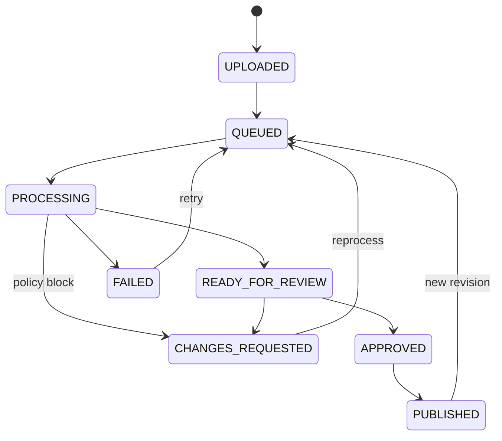

# Asset lifecycle

## States

The database rejects transitions that are absent from this graph. Every accepted transition increments `row_version`, appends a status-history record, and is paired with a domain event and audit evidence at the service boundary.

## Ingestion

The API accepts one multipart file plus `projectId`, optional display name, and comma-separated tags. It only accepts `.gltf` and `.glb`, caps bytes before buffering, and parses the glTF header/document before creating work.

SHA-256 serves three purposes:

1. Content-addressed object keys make immutable writes deterministic.
2. Project-level deduplication prevents accidental duplicate asset records.
3. Version records retain a verifiable link to stored bytes.

JSON `.gltf` files with external URI dependencies are analyzed, but the single-file upload endpoint cannot resolve those external resources. The quality policy therefore flags external buffers or images for review. Embedded data URIs and GLB binary chunks are self-contained and work end to end.

## Processing

Workers poll for `QUEUED` or due `RETRY_WAIT` jobs. A claim transaction:

- selects one eligible row ordered by schedule and creation time;
- locks it with `FOR UPDATE SKIP LOCKED`;
- sets `RUNNING`, worker identity, lease timestamp, and incremented attempt;
- advances the asset to `PROCESSING`;
- returns everything needed to process outside the transaction.

The built-in analyzer extracts scenes, nodes, meshes, primitives, materials, textures, animations, skins, accessors, estimated triangle count, normals/tangents coverage, bounds, and external URI counts. It supports glTF JSON and validates GLB v2 headers and JSON chunks.

## Quality policy

Each project stores quality budgets in JSON. The current policy evaluates findings such as:

- missing geometry;
- triangle count above warning or blocking limits;
- file size above a delivery budget;
- primitives missing normals or tangents;
- external resources that cannot form a self-contained delivery;
- malformed or unsupported glTF structure.

Findings have severity, stable code, human-readable message, and measured/expected context. A `BLOCK` result produces changes requested; `PASS` and `REVIEW` create a pending human review.

## Review and publication

An `ADMIN` or `REVIEWER` can approve or request changes with a summary. Approval records reviewer identity and time, moves the asset through `APPROVED` to `PUBLISHED`, and marks the current delivery version as published. A change request preserves the processor output but prevents delivery publication.

There is intentionally no mutable “latest file.” Consumers resolve the published delivery version, while operators can inspect the complete source/delivery lineage.

## Retry and recovery

Transient failures use capped exponential backoff with jitter. Attempts stop at the job's `max_attempts`; operators can deliberately create a new retry job after investigating a terminal failure. Stale `RUNNING` jobs are recovered when their lease age crosses the configured threshold.

Reprocessing a published or remediated asset creates a new job and revision. Earlier objects, metrics, review decisions, events, and audits remain available.
