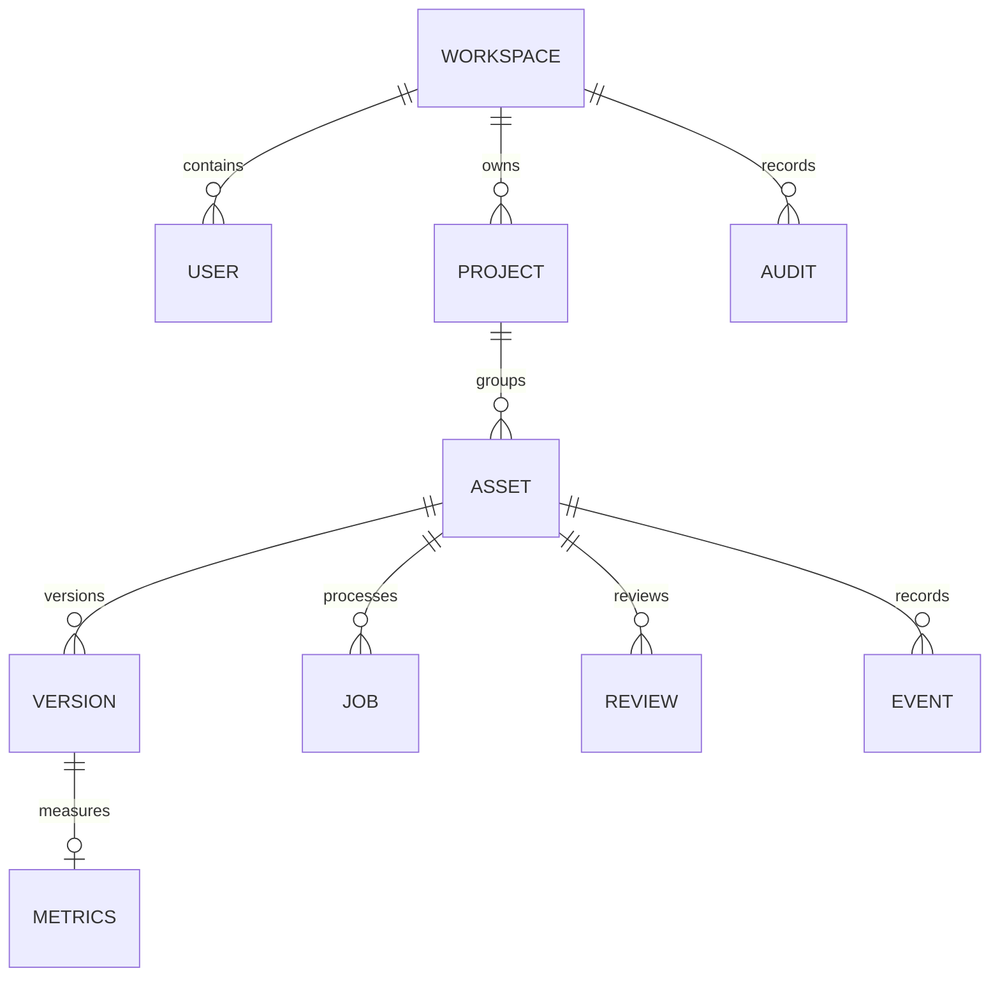

# Data model

ForgeFlow divides domain objects into four schemas, plus a small `platform` schema for migration bookkeeping, so ownership and access patterns remain visible.

| Schema     | Responsibility                      | Core tables                                                                      |
| ---------- | ----------------------------------- | -------------------------------------------------------------------------------- |
| `identity` | Tenant and user identity            | `workspaces`, `users`                                                            |
| `assets`   | Projects, assets, versions, metrics | `projects`, `asset_records`, `asset_versions`, `asset_metrics`, `status_history` |
| `workflow` | Durable work and human decisions    | `jobs`, `reviews`, `events`                                                      |
| `audit`    | Append-only actor evidence          | `events`                                                                         |

## Relationships

## Important invariants

- Email is unique per workspace and stored with `citext` semantics.
- Project keys and asset source hashes are unique inside their intended tenant/project scope.
- A version has one kind (`SOURCE` or `DELIVERY`) and a positive revision.
- Source/delivery object locations, hashes, sizes, and processor versions are immutable lineage evidence.
- Only one pending review is allowed for an asset at a time.
- Job status, schedule, attempt, lease owner, and lease time support crash recovery.
- Audit rows reject `UPDATE` and `DELETE` in a database trigger.
- Asset status updates pass a database lifecycle trigger and increment `row_version`.

## Multi-tenancy

Tenant-owned tables carry `workspace_id`, and repository queries include the authenticated workspace explicitly. Row-level security policies read `forgeflow.workspace_id`, which can be set for a transaction by a restricted runtime role.

The local Docker Compose setup uses the schema owner for convenience; PostgreSQL owners can bypass RLS. A production deployment must use separate roles:

- a migration owner that creates and alters schema objects;
- a login-less object owner where appropriate;
- a restricted runtime role with `FORCE ROW LEVEL SECURITY` or no ownership privileges;
- optionally a read-only analytics role over curated views.

RLS is defense in depth, not a replacement for workspace predicates and authorization tests.

## Indexing

The migrations include indexes for tenant/status asset searches, project/update ordering, source-hash deduplication, due-job claims, pending reviews, event timelines, and audit time order. The due-job index is partial so workers do not scan completed history.

## Migration discipline

Migrations are ordered SQL files. The migrator uses a PostgreSQL advisory lock, records a SHA-256 checksum, and refuses to continue when an already-applied file changes. Forward-only corrective migrations are safer than rewriting published history.
